# LEMP-STACK-Task2
In this project, I set up a website server on AWS using LEMP (Linux, Nginx, MySQL, PHP). It is like the LAMP stack, but it uses Nginx instead of Apache.

## Step 0 – Create the Server

I created an Ubuntu 24.04 server on AWS and logged in with SSH.

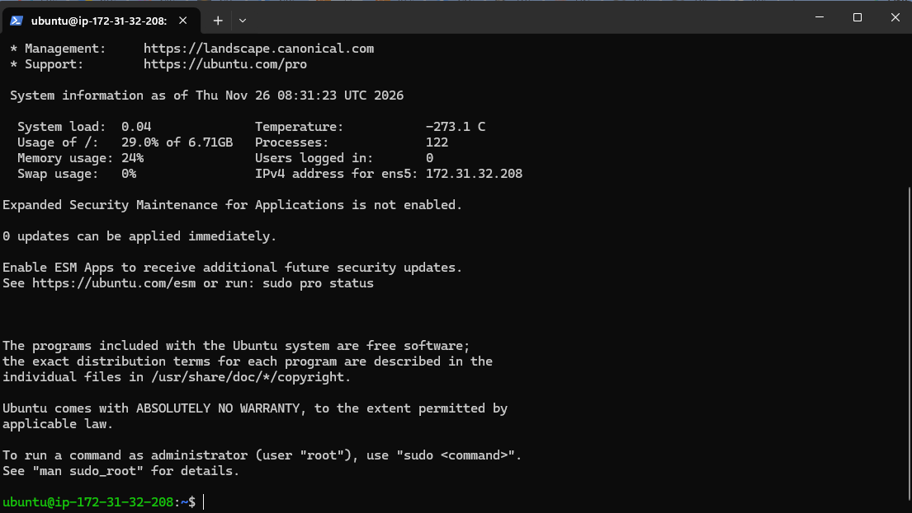

## Step 1 – Install Nginx

Nginx is the web server. It shows websites to visitors.

```bash
sudo apt update
sudo apt install nginx
sudo systemctl status nginx
```

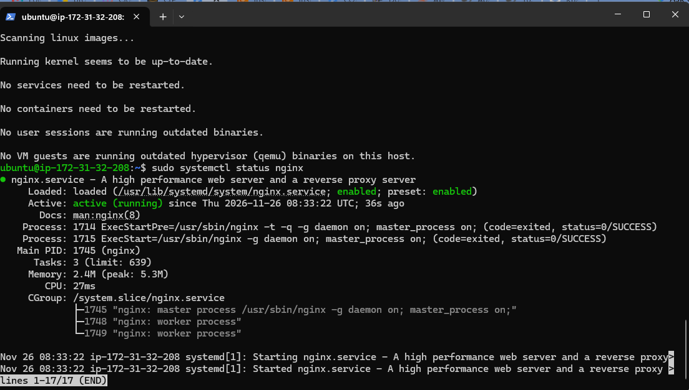

I opened port 80 so people can visit the website.

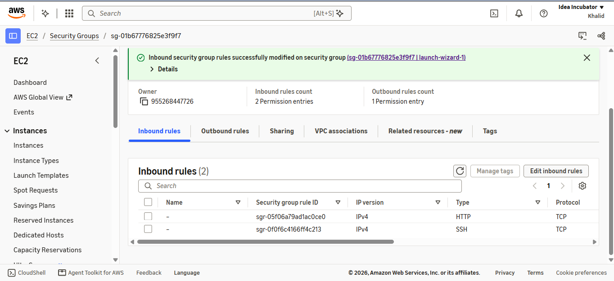

I tested Nginx from inside the server and got my public IP.

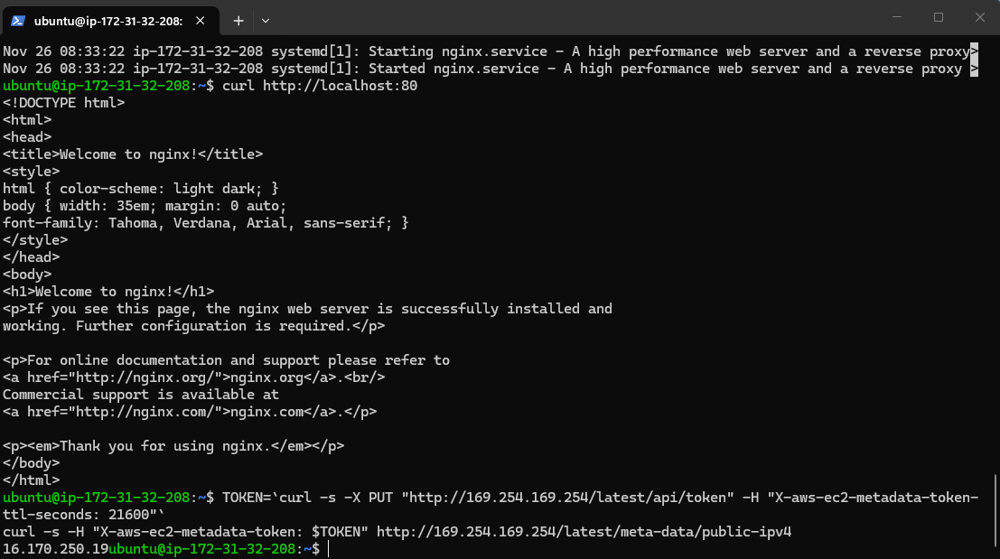

The Nginx page opened in my browser.

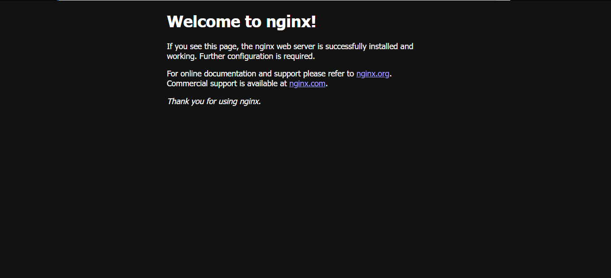

## Step 2 – Install MySQL

MySQL is the database. I set a password for the root user.

```bash
sudo apt install mysql-server
sudo mysql
ALTER USER 'root'@'localhost' IDENTIFIED WITH mysql_native_password BY 'PassWord.1';
exit
```

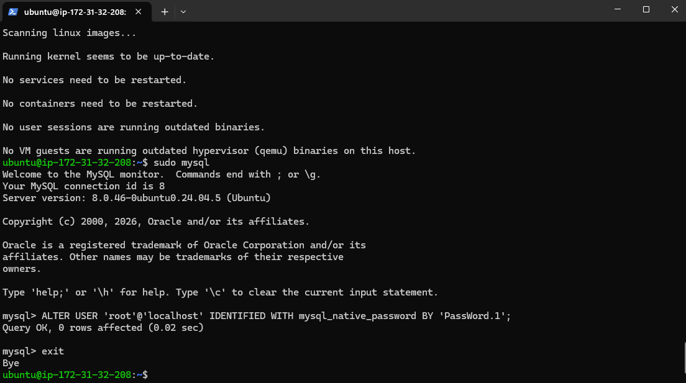

Then I made MySQL more secure and logged in with the password.

```bash
sudo mysql_secure_installation
sudo mysql -p
```

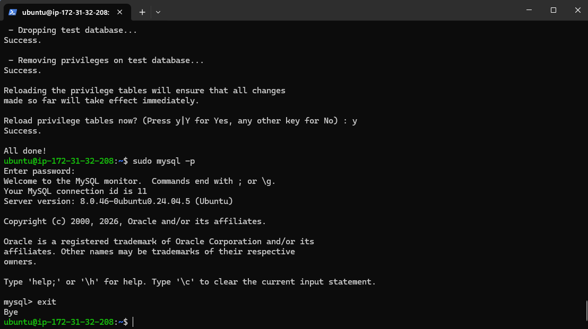

## Step 3 – Install PHP

Nginx cannot run PHP by itself, so I installed php-fpm to help it.

```bash
sudo apt install php-fpm php-mysql
php -v
```

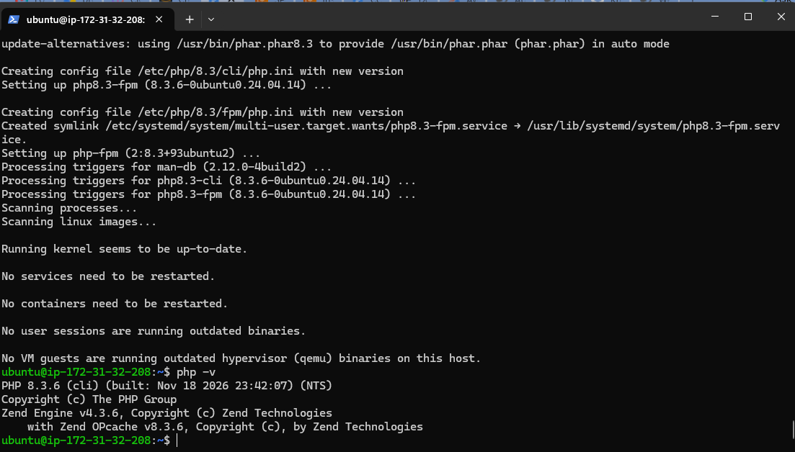

## Step 4 – Set Up Nginx for My Website

I made a folder for my website and a config file that tells Nginx to use it.

```bash
sudo mkdir /var/www/projectLEMP
sudo chown -R $USER:$USER /var/www/projectLEMP
sudo nano /etc/nginx/sites-available/projectLEMP
sudo ln -s /etc/nginx/sites-available/projectLEMP /etc/nginx/sites-enabled/
sudo nginx -t
sudo unlink /etc/nginx/sites-enabled/default
sudo systemctl reload nginx
```

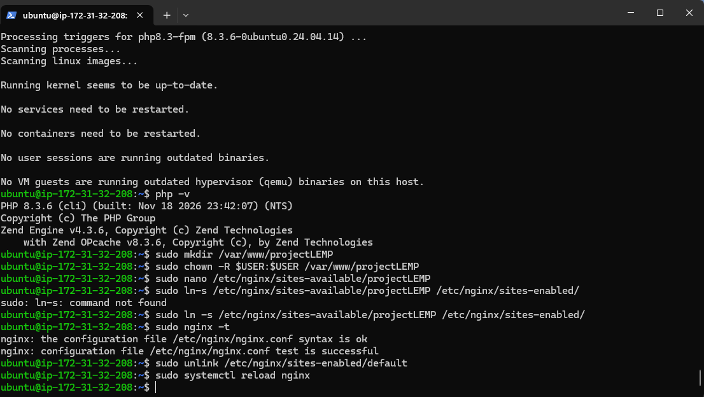

My test page opened with the IP address and with the web address.

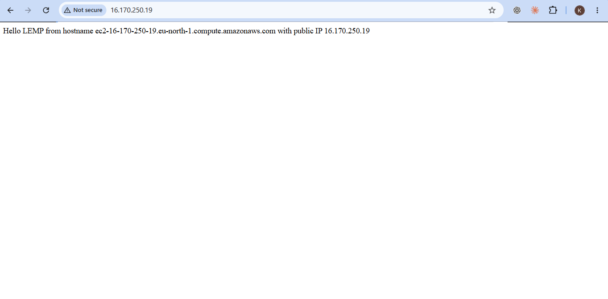

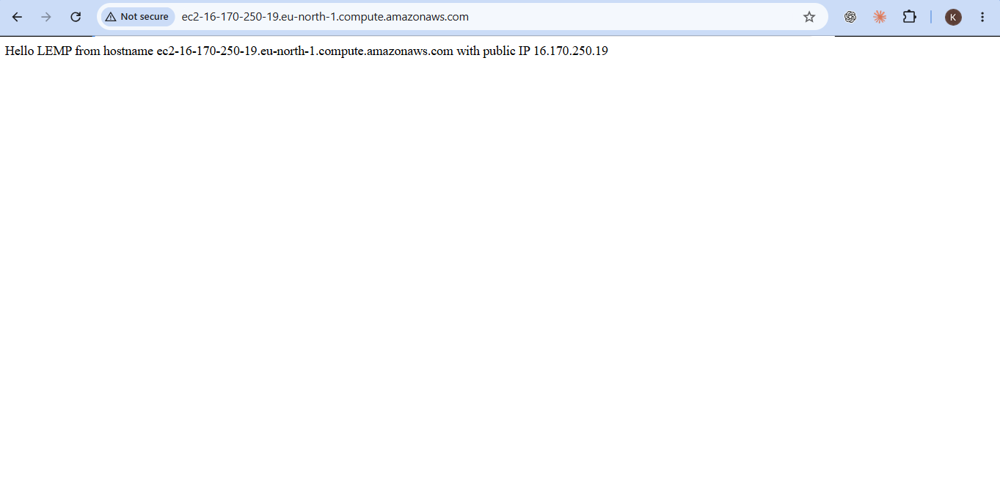

## Step 5 – Test PHP

I made a PHP test page to check that Nginx can run PHP.

```php
<?php
phpinfo();
```

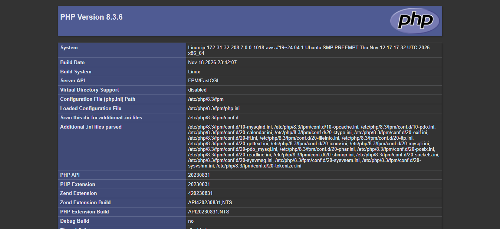

Then I deleted the test page to keep the server safe.

## Step 6 – Show Data from MySQL with PHP

I made a database and a user, then logged in as the new user.

```sql
CREATE DATABASE `example_database`;
CREATE USER 'example_user'@'%' IDENTIFIED WITH mysql_native_password BY 'PassWord.1';
GRANT ALL ON example_database.* TO 'example_user'@'%';
```

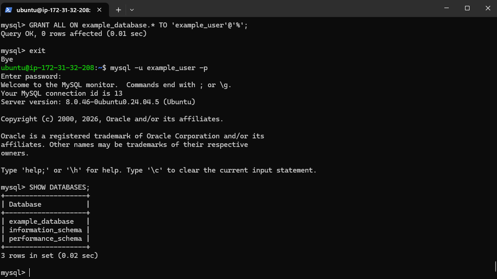

I made a to-do list table and added 4 items.

```sql
CREATE TABLE example_database.todo_list (
  item_id INT AUTO_INCREMENT,
  content VARCHAR(255),
  PRIMARY KEY(item_id)
);
INSERT INTO example_database.todo_list (content) VALUES ("My first important item");
SELECT * FROM example_database.todo_list;
```

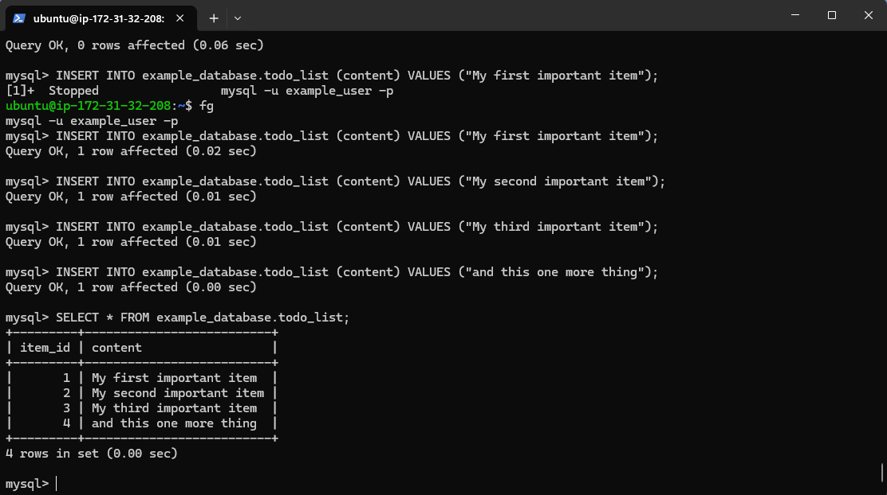

Then I wrote a PHP page that reads the list from the database and shows it in the browser.

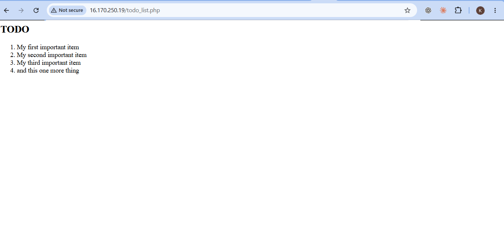

## Problems I Fixed

- I typed `ln-s` without a space and got "command not found". The right command is `ln -s`.
- My PHP page showed HTTP Error 500. I checked the error log and saw that the code had been pasted twice. I deleted the file and made it again.
- I made typos in folder names, like `www.projectLEMP` instead of `www/projectLEMP`. Checking the path fixed it.
- I pressed Ctrl+Z by mistake, which paused MySQL. I typed `fg` to bring it back.

## Changes from the Guide

- I used Ubuntu 24.04 and t3.micro, because Ubuntu 22.04 and t2.nano were not available in my region.
- I used PHP 8.3, so the config file says php8.3-fpm.sock instead of php8.1.
- I used a strong password for example_user, because "password" was too weak for the password check.

## What I Learned

- How Nginx is different from Apache
- How Nginx uses php-fpm to run PHP
- How to use the nano editor
- How to create a database, a user and a table in MySQL
- How to read data from MySQL with PHP
- How to find errors using the error log
